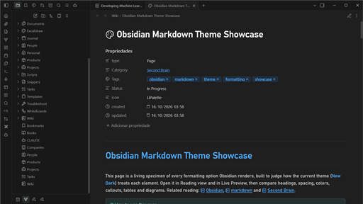

# New Dark

New Dark is an Obsidian theme that brings the look of Visual Studio Code's Dark Modern to your notes: near-black surfaces, hairline grey borders, small rounded corners, and a calm blue accent. A matching light mode follows VS Code's Light Modern, so the theme works with either Base color scheme.



## Highlights

- **Familiar, quiet surfaces.** The editor sits on `#1f1f1f` while the sidebars, ribbon, titlebar, and status bar use a deeper `#181818`, separated by 1px `#2b2b2b` borders.
- **Headings and bold text in the accent color.** Headings and bold words stand out against body text without extra weight, in both Live Preview and Reading view.
- **VS Code syntax colors in code blocks.** Keywords, strings, functions, properties, and comments use the same token palette as the editor that inspired the theme.
- **Tables that fit the pane.** Wide tables reflow inside the window and wrap long cells instead of scrolling sideways.
- **A wide reading column.** Notes use 95% of the pane width, which gives tables and diagrams more room. Mermaid diagrams are centered and only scroll when they are truly too wide.
- **Cleaner Live Preview.** Line numbers are hidden in Live Preview and stay visible in Source mode.
- **Print-ready PDF export.** Exported PDFs use point-based type sizes, a print-friendly font, and no headings stranded at the bottom of a page.
- **Light and dark in one theme.** Both modes define the same variables, so switching Base color scheme never leaves a half-styled interface.

## Install

### From the community directory

1. Open **Settings → Appearance**.
2. Under **Themes**, click **Manage**.
3. Search for **New Dark**, then click **Install and use**.
4. Pick **Dark** or **Light** under **Base color scheme**. New Dark styles both.

### Manually

1. Download `manifest.json` and `theme.css` from the [latest release](https://github.com/compadrejunior/obsidian-theme-new-dark/releases/latest).
2. Create the folder `<your vault>/.obsidian/themes/New Dark/` and put both files in it. The folder name must match the `name` field in `manifest.json`.
3. Restart Obsidian, open **Settings → Appearance**, and select **New Dark** in the **Themes** dropdown.

Obsidian reads `manifest.json` only on startup, so restart the app after you replace it with a newer version.

## Recommended settings

| Setting | Suggestion |
| --- | --- |
| Base color scheme | **Adapt to system**, or pick one. Both modes are designed together. |
| Accent color | Leave on **Default**. The theme sets the accent itself, and a custom accent only changes buttons and toggles. |
| Font size | The theme sets 15px for note text. Use the **Font size** slider to change it. |
| Readable line length | You can leave it on or off. New Dark widens the column to 95% either way. |
| Monospace font | New Dark prefers **CaskaydiaCove Nerd Font Mono**, then Cascadia Code and Consolas. Install a font to see it, or set your own under **Appearance → Monospace font**. |

## Customize

New Dark is built entirely from Obsidian's CSS variables, so you can change it with a small CSS snippet and no forking. Save a `.css` file in `<your vault>/.obsidian/snippets/`, then enable it under **Settings → Appearance → CSS snippets**.

For example, to switch the accent used by headings, bold text, and links in dark mode:

```css
.theme-dark {
  --text-accent: #4ec9b0;
  --text-accent-hover: #7ddcc8;
  --link-color: #4ec9b0;
}
```

Use `.theme-dark` and `.theme-light` as the selectors for colors, because New Dark defines its colors there and a rule on `body` alone has a lower priority. The [user guide](docs/user-guide.md) lists every variable worth changing, with more snippets for headings, code, tables, radii, and page width.

## What gets styled

New Dark covers the app interface (titlebar, tabs, ribbon, sidebars, file explorer, status bar, modals, prompts, menus, buttons, inputs, toggles, and scrollbars) and the note content (headings, links, tags, lists, blockquotes, callouts, code, tables, horizontal rules, and the inline title). Community plugins that use Obsidian's standard variables pick up the theme automatically.

It does not restyle Obsidian Publish sites. A separate, intentionally tiny `publish.css` is included in the repository for that purpose, see the [documentation](docs/README.md) before using it.

## Compatibility

- Requires Obsidian 1.0.0 or later.
- Designed for desktop. Mobile uses the same CSS, but the layout has not been tuned for small screens yet.
- Works with the Light and Dark Base color schemes, and with CSS snippets that override its variables.

## Troubleshooting

**The theme does not appear in the list.** Check that the folder is named exactly `New Dark` and sits in `<vault>/.obsidian/themes/`, then restart Obsidian.

**A snippet of mine stopped working.** Move your snippet's color rules under `.theme-dark` or `.theme-light`, as shown above. Rules on `body` apply only to variables that New Dark sets under `body`, such as heading and bold colors.

**Code looks different between editing and reading.** Obsidian uses two syntax highlighting libraries, so a few tokens differ slightly between Live Preview and Reading view.

**Something else looks off.** Press `Ctrl+Shift+I` (`Cmd+Option+I` on macOS) to inspect the element, then [open an issue](https://github.com/compadrejunior/obsidian-theme-new-dark/issues) with a screenshot and the Obsidian version.

## Develop

The theme is written in SCSS and compiled to a single `theme.css`.

1. Run `npm install`.
2. Run `npm run build` to compile `src/theme.scss` into `theme.css`.
3. Point `OBSIDIAN_VAULT` at a test vault and run `npm run link` once. This links the repository into the vault as an installed theme.
4. Run `npm run watch` to rebuild on every save, then reload the theme in Obsidian.
5. Run `npm run verify` before every commit. It lints the SCSS, builds the CSS, and validates the output against Obsidian's submission rules.

`theme.css` is committed because Obsidian's directory and the release read it directly, so never edit it by hand. The [documentation folder](docs/README.md) explains every Obsidian CSS variable and the publishing rules.

## Contributing

Bug reports and ideas are welcome in the [issue tracker](https://github.com/compadrejunior/obsidian-theme-new-dark/issues). For code changes, edit the files in `src/`, run `npm run verify`, and describe in the pull request which part of the interface changed, ideally with before and after screenshots in both color schemes.

## Changelog

See [CHANGELOG.md](CHANGELOG.md).

## License

MIT, see [LICENSE](LICENSE).
